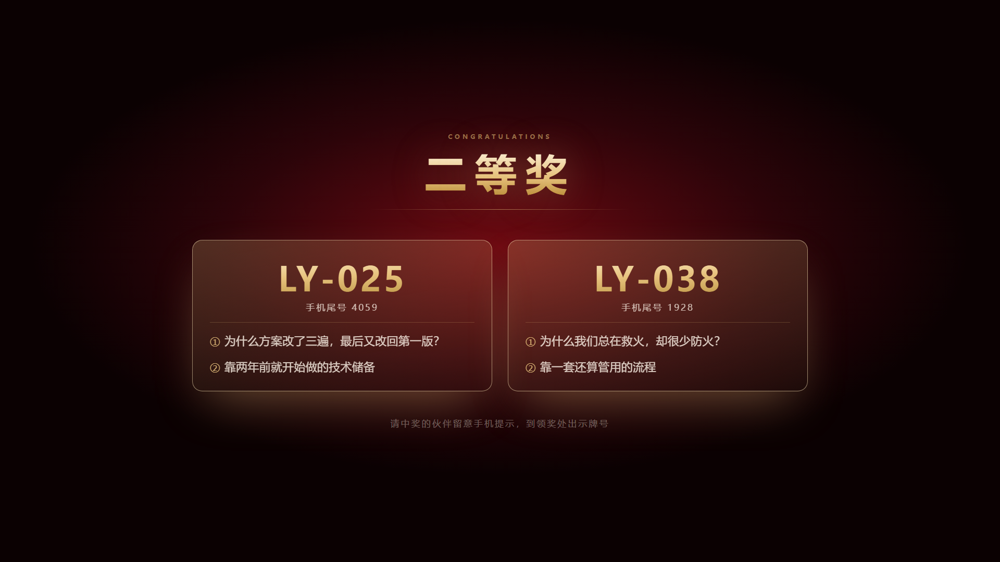
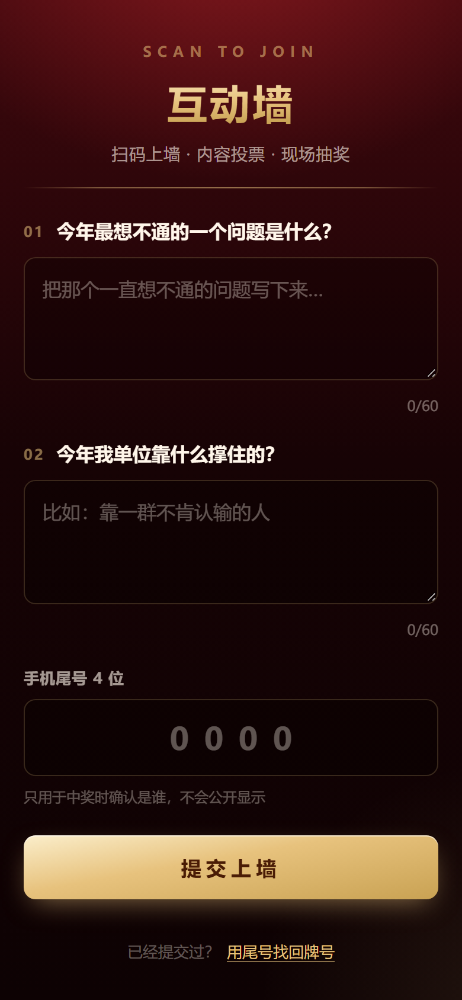
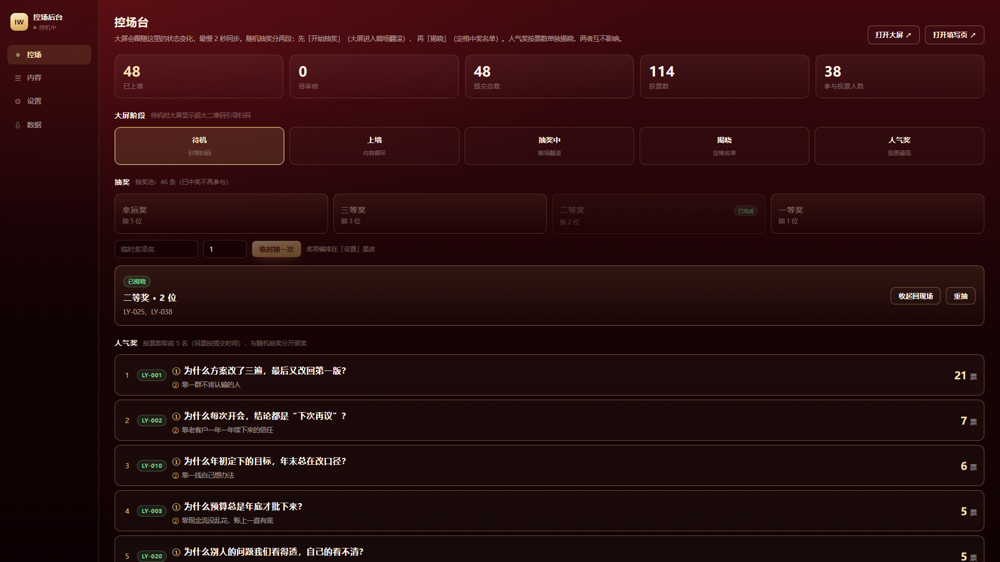

<h1 align="center">interactive-wall · 互动墙</h1>

<p align="center">扫码上墙 · 内容投票 · 现场抽奖 —— 一块大屏搞定</p>

<p align="center">
  
  
  
  
</p>

<p align="center"><sub>A self-hostable live event wall. Guests scan a QR code, answer two prompts, watch their answer appear on the big screen, vote for each other, and see a live prize draw — no database, no external service, no build step on the server.</sub></p>

---

适合论坛、年会、晚宴、发布会这类有「一块大屏 + 一群在场观众」的场景。观众扫码留下两句话，内容滚动上墙；彼此投票选出人气内容；主持人按奖项现场抽奖，中奖者的手机会同时弹出提醒。

整个项目是**一个零依赖的 Node 进程加一个 JSON 文件**。没有数据库、没有 Redis、没有 WebSocket 服务，解压就能跑，100~200 人规模不需要调任何参数。

### 三个入口

| 入口 | 路径 | 用途 |
| --- | --- | --- |
| 大屏 | `/screen` | 投屏展示：待机二维码、内容墙轮播、人气榜、抽奖舞台 |
| 手机 | `/submit` · `/wall` · `/me` | 扫码填写、逛内容墙投票、查看自己的牌号与中奖提醒 |
| 后台 | `/admin` | 控场切阶段、审核内容、抽奖、改设置、导出数据 |

---

## 目录

- [功能](#功能)
- [截图](#截图)
- [快速开始](#快速开始)
- [部署](#部署)
- [现场怎么用](#现场怎么用)
- [数据与备份](#数据与备份)
- [环境变量](#环境变量)
- [设计取舍](#设计取舍)
- [目录结构](#目录结构)
- [API](#api)
- [常见问题](#常见问题)

---

## 功能

### 大屏 `/screen`

- **待机页**：超大二维码 + 两个问题预览 + 实时「已上墙 / 已投票」计数，观众提前扫码就能写。
- **内容墙**：一屏 9 条卡片，按设定秒数自动翻页；右侧常驻人气榜 Top 8；新上墙的内容会亮一次金框。
- **抽奖舞台**：点「开始抽奖」后大屏暗场、牌号翻滚；点「揭晓」定格中奖名单。两段式由主持人控制节奏。
- **中奖名单自适应**：1~3 人显示带答案的内容卡；4 人以上自动切成牌号大字网格，后排也看得清；超过 20 人自动分页，每页 20 张、8 秒一轮。
- **人气奖**：按票数取前 N 名，左侧第 1 名大卡 + 右侧 2~N 名竖排，与随机抽奖互不影响。
- **全文浮层**：点任意卡片，或按数字键 `1`~`9`，弹出这条内容的完整回答，15 秒后自动收起。
- 三套主题（红金 / 蓝紫 / 墨金），支持上传背景图并自动压暗保证文字可读。

### 手机端

- 扫码填写两个问题，可选填 4 位手机尾号，提交后立刻拿到专属牌号（如 `LY-023`）。
- 内容墙逐条浏览，**每人固定 3 票**，同一内容不能重复投，投完即止。
- `/me` 查看自己的牌号、状态、剩余可编辑时间；中奖时弹出全屏提醒。
- 提交后 10 分钟内可修改答案，牌号不变。
- 忘了牌号可以凭手机尾号找回（换浏览器、清缓存都不怕）。

### 后台 `/admin`

- **控场**：待机 / 内容墙 / 抽奖中 / 揭晓 / 人气奖 五个阶段一键切换，大屏 2 秒内跟随。
- **内容**：审核队列、单条遮蔽（不删除、可恢复）、举报计数、手动通过或下墙。
- **抽奖**：按奖项抽人、重抽（自动排除已中奖）、查看历次结果。
- **设置**：标题副标题、两问文案、字数上限、投票规则、敏感词、每页秒数、奖项与人数、人气奖人数、主题与背景图、二维码地址。
- **数据**：导出提交 / 投票 / 中奖 CSV，下载全量 JSON 备份，重置本场活动（清数据、保留设置）。

---

## 截图

**内容墙** — 一屏九条，自动翻页，右侧人气榜


**抽奖揭晓** — 两段式，主持人喊完再定格



**人气奖** — 票王单独一张大卡，其后竖排


| 手机填写 | 中奖提醒 | 后台控场 |
| :---: | :---: | :---: |
|  |  |  |

<details>
<summary>更多截图</summary>

| 待机页 | 抽奖翻滚 |
| :---: | :---: |
|  |  |


</details>

---

## 快速开始

需要 Node **16 或更高**（构建前端需要 18+，用的是 Vite 6）。

```bash
git clone https://github.com/mushu707/interactive-wall.git
cd interactive-wall
npm install
npm run dev
```

`npm run dev` 会同时起后端（`:3000`）和前端（`:5173`），打开 <http://localhost:5173/screen> 就是大屏。

灌一批演示内容：

```bash
npm run seed        # 36 条
npm run seed 100    # 100 条
```

> `npm run seed` 会清空现有提交、投票、抽奖记录。
> 只想单独起某一端时用 `npm run dev:web` / `npm run dev:server`。

后台默认密码是 `admin888`，正式使用前务必换掉（见[环境变量](#环境变量)）。

### 彩排模拟

`scripts/sim.mjs` 会真打 HTTP 接口灌数据 —— 牌号自增、设备去重、敏感词、投票上限、写熔断全都走一遍，比直接改 JSON 更接近现场。

```bash
npm run sim -- --users 30 --submit-secs 30 --vote-secs 20   # 半分钟跑一遍全流程
npm run sim -- --reset --users 120                          # 先清空再模拟 120 人
npm run sim -- --reset-only                                 # 只清空
```

脚本启动时会把大屏切到内容墙，另开一个 `/screen` 窗口就能边跑边看。参数全表见 `scripts/sim.mjs` 文件头（人数、参与比例、时长、边界样本、随机种子、目标地址等）。

> 模拟器依赖全局 `fetch`，需要 Node 18+；站点本身 16 就能跑。

---

## 部署

### 它不是一个纯静态站

`npm run build` 的产物在 `dist/`，但页面要靠 `server/index.js` 提供 `/api/*` 并读写数据。只把 `dist/` 传到静态托管上，页面能打开，但大屏很快提示「连接失败」，提交和后台都会失败。

```
Nginx / Caddy (:80/:443) ──反代──> node server/index.js (:3000)
                                     ├─ 托管 dist/
                                     ├─ 提供 /api/*
                                     └─ 读写 data/db.json、data/uploads/
```

### 构建与启动

```bash
npm install
npm run build
PORT=3000 node server/index.js
```

后端零依赖，`npm install` 只是装前端构建工具。想直接打包一个不含 `node_modules` 的发布目录：

```bash
npm run pack        # 生成 release/interactive-wall.zip
```

### 反向代理

不要让观众访问 `http://你的域名:3000`：二维码里会带端口，而很多场地网络只放行 80/443。用 Nginx 把 80 反代到本机 3000 即可，端口要和 `PORT` 保持一致。

```nginx
location / {
    proxy_pass http://127.0.0.1:3000;
    proxy_set_header Host $host;
    proxy_set_header X-Real-IP $remote_addr;
    proxy_set_header X-Forwarded-For $proxy_add_x_forwarded_for;
    proxy_set_header X-Forwarded-Proto $scheme;
}
```

强烈建议配 HTTPS：没有 HTTPS 时，安卓微信打开 http 页面可能弹「非官方网页」提示。

<details>
<summary>用宝塔面板部署（点击展开）</summary>

1. **装 Node**：软件商店 → Node.js 版本管理器 → 安装 v18 或以上（站点本身 v16 也能跑）。
2. **上传**：文件 → `/www/wwwroot/` → 上传 `release/interactive-wall.zip` → 解压。
3. **建 Node 项目**：网站 → Node 项目 → 添加，项目目录选解压出来的目录，启动文件填 `server/index.js`，端口填 `3000`，运行方式用 PM2。
4. **开机自启**（容易漏）：终端执行 `pm2 save` 和 `pm2 startup`，后者会打印一行 `sudo env PATH=...`，把它原样再执行一次。
5. **反代**：网站 → 添加站点（纯静态）→ 设置 → 反向代理 → 目标 `http://127.0.0.1:3000`。
6. **防火墙**：只放行 80/443，关掉 3000。

升级时**直接解压覆盖**即可，`data/` 不会被冲掉（发布包里不含数据文件）。不要在解压前清空站点目录。

</details>

---

## 现场怎么用

**开场前**：大屏电脑打开 `/screen` 按 F11 全屏；后台把阶段设为「待机」，观众可以先扫码填写；用手机流量（不是场地 WiFi）走一遍扫码 → 提交 → 投票，确认链路通。

**开场**：后台点「上墙」，内容开始轮播。

**抽奖**：后台 → 抽奖 → 点某个奖项 → 大屏暗场翻滚 → 主持人念完 → 点「揭晓」→ 名单定格，中奖者手机同时弹出提醒。抽错了点「重抽」，新一轮自动排除刚才中奖的人。

**人气奖**：后台 → 控场 → 人气奖 →「大屏揭晓」。人数在设置里改（默认 5，最多 6）。同票按提交时间先后排序，与随机抽奖互相独立，同一个人可以两个都拿。

**内容不合适**：后台 → 内容 →「遮蔽」，大屏 2 秒内消失，不删除、可恢复。命中敏感词的内容不会上墙，会进「待审」；被举报到阈值也会自动下墙。

**活动结束**：后台 → 数据 → 导出 CSV 和全量 JSON 各一份。

### 大屏快捷键

| 按键 | 作用 |
| --- | --- |
| `←` `→` | 手动翻页（揭晓名单超过 20 人时翻名单） |
| `空格` | 暂停 / 继续自动翻页 |
| `1`~`9` | 打开对应位置卡片的全文 |
| `Esc` | 关闭浮层 |
| `H` | 呼出控场浮层（后台进不去时的应急入口） |

---

## 数据与备份

| 文件 | 说明 |
| --- | --- |
| `data/db.json` | 全部数据：提交、投票、抽奖、设置、日志 |
| `data/db.prev.json` | 上一版自动备份（每次落盘前生成） |
| `data/snapshots/*.json` | 每 10 分钟一份快照，保留最近 60 份 |
| `data/uploads/` | 上传的背景图 |

写入采用「临时文件 + rename」，进程被杀也不会留下半截 JSON。

**备份** = 把整个 `data/` 目录拷走。**恢复** = 放回去再重启。

换一场活动：后台 → 数据 → 重置活动。清空提交、投票、抽奖，牌号从 `LY-001` 重新开始，标题、问题、奖项等设置全部保留。

---

## 环境变量

复制 `.env.example` 为 `.env`，或直接用系统环境变量（系统环境变量优先）。

| 变量 | 默认值 | 说明 |
| --- | --- | --- |
| `PORT` | `3000` | 监听端口，需与反向代理目标一致 |
| `ADMIN_PASSWORD` | `admin888` | 后台密码，**正式使用前必须修改** |
| `WRITE_PER_MIN` | `1500` | 全站写请求熔断（次/分钟），下限 400 |
| `SESSION_SECRET` | 自动生成 | 会话签名密钥，留空则保存在 `data/.session_secret` |
| `DATA_DIR` | `./data` | 数据目录，可指向独立磁盘 |

大部分现场参数（标题、两问、票数、奖项、主题等）都在后台「设置」里改，不需要动环境变量。

---

## 设计取舍

几个看起来「多余」、其实是为了现场不出事的选择：

- **JSON 文件而不是数据库**：部署时少一个组件就少一个故障点。100 人量级单次落盘不到 2ms，配快照和回滚完全够用。
- **轮询而不是 WebSocket**：大屏 2 秒拉一次、抽奖时 700ms 一次，用 4 秒翻滚动画把延迟吃掉，主持人喊完 "3、2、1" 大屏一定已经到位。少了长连接，也就少了断线重连的一堆边界情况。
- **按设备限流，不按 IP**：现场所有人连同一个 WiFi，出口 IP 一样，按 IP 节流会把全场一起打死。
- **每人 3 票**：不是「每个牌号都能点一次」。无限点赞的结果是榜单等于拉票人数，稀缺才有真实评选。
- **只收 4 位手机尾号**：中奖时大屏显示 `LY-023 · 尾号 1234`，手机端弹提醒，领奖按牌号核对。不收姓名，尾号默认也不上墙。
- **抽奖两段式**：开始和揭晓分开，节奏交给主持人，程序不猜什么时候该停。

---

## 目录结构

```
├─ server/                 零依赖后端
│  ├─ index.js             HTTP 服务 + 静态托管 + .env 读取
│  ├─ api.js               全部接口、限流、抽奖、导出
│  ├─ store.js             JSON 存储：原子写 / 快照 / 回滚
│  ├─ auth.js              HMAC 签名 Cookie 会话
│  ├─ quotes.js            演示题库（seed 与 sim 共用）
│  └─ seed.js              演示数据
├─ src/
│  ├─ pages/               Screen / Submit / Me / Wall / Admin
│  ├─ components/admin/    后台四个面板
│  ├─ styles/              theme.css（设计变量）· admin.css
│  └─ api.js  state.js  router.js  adminStore.js
├─ scripts/                pack.mjs（发布打包）· zip.mjs（零依赖 ZIP）
│                          sim.mjs（彩排模拟）· qa.mjs（布局自检）· dev.mjs
└─ data/                   db.json · db.prev.json · snapshots/ · uploads/
```

---

## API

公共接口：

```
GET   /api/public/config                      站点配置（标题、两问、字数上限）
GET   /api/public/screen                      大屏所需全部数据（含版本号，用于判断是否重绘）
GET   /api/public/wall                        内容墙列表
POST  /api/public/submissions                 提交内容
PATCH /api/public/submissions/:id             修改内容（10 分钟窗口内）
POST  /api/public/find                        凭尾号找回牌号
POST  /api/public/votes                       投票
POST  /api/public/report                      举报
```

管理接口（需登录，`POST /api/admin/login` 取得会话）：

```
GET    /api/admin/state
PUT    /api/admin/settings
POST   /api/admin/phase                        切换阶段
POST   /api/admin/draw/prepare                 开始抽奖
POST   /api/admin/draw/reveal                  揭晓
POST   /api/admin/draw/redraw                  重抽
PATCH  /api/admin/submissions/:id              审核 / 遮蔽
DELETE /api/admin/submissions/:id
POST   /api/admin/submissions/:id/reset-likes  单条清赞
POST   /api/admin/upload                       上传背景图
GET    /api/admin/export/{submissions|likes|draws}.csv
GET    /api/admin/backup                       全量 JSON
POST   /api/admin/reset                        重置活动（保留设置）
```

---

## 常见问题

**只部署 `dist/` 能跑吗？**
不能。本项目带 Node 后端，必须有一个常驻进程处理 `/api/*`，详见[部署](#部署)。

**扫码打不开？**
确认手机用的是移动网络而不是场地 WiFi；再看域名是否被微信拦截。

**大屏提示「连接失败」？**
前端连不上 `/api`：Node 进程挂了、反向代理指错端口，或者被当静态站部署了。

**大屏一直显示「还没有内容上墙」？**
设置里的「自动上墙」关了，或者内容都命中了敏感词，去后台「内容」看状态。

**忘了后台密码？**
改环境变量 `ADMIN_PASSWORD`，重启进程。

**想让一台手机提交多条？**
设置 → 参与与投票规则 → 打开「允许一台手机提交多条」。适合帮邻座代填，但一人多票的风险也会上来。

**能换主题色吗？**
设置 → 主题色：红金 / 蓝紫 / 墨金。也可以上传背景图，会自动压暗。

**同一个人能既中随机奖又拿人气奖吗？**
可以，两个奖互相独立。后台会给已中奖的人标一句「已中某奖」，方便主持人心里有数。

---

## License

[MIT](LICENSE)
